# Smart Warehouse Robot Simulator
### Comparing AI Agents and Pathfinding Algorithms

**Course:** AL-2002 Artificial Intelligence Laboratory · **University:** FAST-NUCES, Karachi · **Semester:** Fall 2026

| Role | Name | Roll No. | Section |
|---|---|---|---|
| Project Leader | Anas Haider | 24K-2002 | BSCY-5A |
| Member | Shayan Hassan | 24K-2050 | BSCY-5A |

Repository: <https://github.com/anashaider/SmartWarehouseAI>

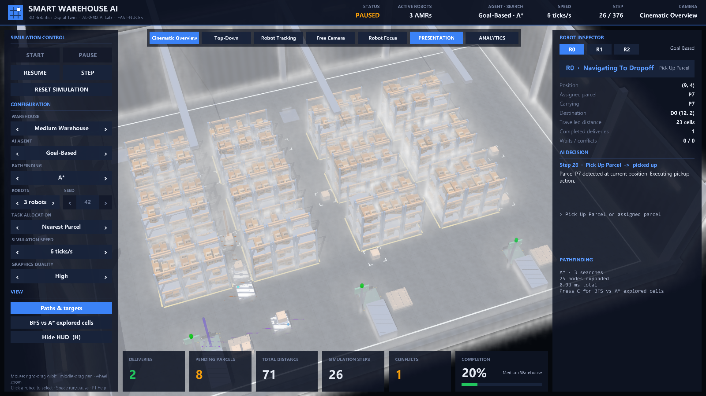

---

## 1. Overview

A grid-based warehouse in which two or three robots collect parcels from storage
pick faces and deliver them to drop-off stations while avoiding shelves and each
other. The project implements and **measures**:

| Category | Implemented |
|---|---|
| Agents | Simple Reflex, Goal-Based, Utility-Based |
| Search | Breadth-First Search, A* (Manhattan heuristic) - both written from scratch |
| Baselines | Fixed-order task allocation vs nearest-parcel allocation; BFS as the search baseline |
| Coordination | Deterministic rotating turn order, vertex/edge reservation checks, priority-based deadlock retreat |
| Evaluation | 24 seeded scenarios × 12 configurations (288 full simulations) + 1,920 search queries |

Every metric, animation, decision explanation and chart is produced by the real
simulation engine - nothing is hard-coded.

The project has two front-ends on the same engine:

- **3D digital twin (default)** - Panda3D: a realistic warehouse with racks, docks and AMR robots, shadows and post-processing, five camera modes, an opening flythrough, a command-center HUD and a Presentation Mode driven by real simulation events. See [docs/VISUALIZATION_3D.md](docs/VISUALIZATION_3D.md).
- **2D dashboard (fallback / `--2d`)** - Pygame, lightweight, starts automatically if 3D is unavailable.

## 2. Problem Statement

Warehouses must move goods between storage and delivery areas efficiently. A
robot must find a valid route around shelves and other robots, and different
decision-making strategies and search algorithms trade off path quality, search
effort and robustness. This project models such a warehouse and compares the
three classic agent architectures and two uninformed/informed search algorithms
on identical, reproducible scenarios.

**PEAS**

| | |
|---|---|
| Performance | parcels delivered, distance travelled, completion steps, nodes expanded, runtime, conflicts, invalid moves |
| Environment | discrete 2-D grid: floor, shelves, parcels, delivery stations, 2-3 robots |
| Actuators | Move Up / Down / Left / Right, Pick Up Parcel, Deliver Parcel, Wait |
| Sensors | own position/state/heading, the 4 adjacent cells, target location, other robots' positions |

Environment properties: fully observable map, deterministic, discrete, sequential, multi-agent (cooperative), dynamic because the other robots move.

## 3. Features

- **3D digital twin:** procedural industrial warehouse (steel racks with cartons, floor safety tape, loading docks with conveyors, charging pads), detailed robots (wheels, lidar, lift, status beacon, ID panel), shadows, bloom and SSAO, three quality presets, five smoothly blended cameras with occlusion avoidance, BFS/A* explored cells revealed in real expansion order, and a cinematic Presentation Mode.
- **Interactive Pygame dashboard** (dark navy theme): start / pause / resume / step / reset, robot count, agent, algorithm, task allocation, layout (small / medium / large / seeded random), seed, speed slider.
- **Live warehouse view:** smooth robot motion interpolated between the cells actually occupied, heading indicators, carried parcels, planned paths, target markers, occupied-cell and reservation indicators, pickup/delivery/conflict/yield animations, and waiting badges.
- **Explainability:** for every decision, the robot inspector shows the percepts, the available actions (with utility scores for the Utility-Based agent), the chosen action and a plain-language reason. The full decision history is browsable.
- **BFS vs A\* overlay:** both searches are run from the selected robot to its target. The view draws both paths and the cells each one expanded, and the panel compares path length, nodes expanded/generated and runtime.
- **Performance bar:** deliveries, pending parcels, distance, steps, invalid moves, robot conflicts, nodes expanded, completion %.
- **Analytics screen:** runs the full experiment suite inside the app without freezing it, then shows the 8 charts and summary tables.
- **Experiment runner (CLI):** reproducible, seeded, exports CSV + JSON + PNG charts.
- **Robust I/O:** missing or corrupted layout/result files are detected and handled with clear messages and fallbacks.
- **158 automated tests**, including headless tests that click the real 2D dashboard buttons and offscreen tests of the 3D digital twin.

## 4. Technology Stack

Python 3.11+ · Panda3D (3D) · Pygame (2D) · NumPy · Matplotlib · Pandas · Pytest · JSON. Fully offline, no paid APIs, no external pathfinding libraries, no downloaded 3D assets.

## 5. Installation

```bash
git clone https://github.com/anashaider/SmartWarehouseAI.git
cd SmartWarehouseAI
python -m venv .venv
# Windows:  .venv\Scripts\activate        macOS/Linux:  source .venv/bin/activate
pip install -r requirements.txt
```

## 6. Running

```bash
python main.py                                    # 3D digital twin (falls back to 2D automatically)
python main.py --quality high --present           # 3D, high graphics, start in Presentation Mode
python main.py --quality low --no-intro           # 3D for slow GPUs, skip the opening flythrough
python main.py --2d                               # classic 2D dashboard
python main.py --layout large --agent utility_based --algorithm bfs --robots 2
python main.py --layout random --seed 123         # seeded random warehouse
python main.py --headless --layout medium         # one run without a window, prints metrics
python main.py --experiments                      # full experiment suite (~1 min) -> data/results/
python main.py --screenshot out.png --ticks 25    # render the 2D dashboard to a PNG (no window)
python main.py --screenshot3d out.png --camera follow --quality high   # render the 3D twin offscreen
```

3D controls: `Space` run/pause, `S` step, `R` reset, `1-3`/`Tab`/click select robot, `O` overview, `T` top-down, `F` robot tracking, `V` free camera, `G` robot focus, right-drag orbit, middle-drag pan, wheel zoom, `C` BFS vs A* explored cells, `P` Presentation Mode, `A` analytics, `H` hide HUD, `Q` graphics quality, `F1` help, `Esc` close/skip.

2D keyboard shortcuts: `Space` start/pause/resume, `S` step, `R` reset, `Tab`/`1-3` select robot,
`C` BFS-vs-A* overlay, `+`/`-` speed, `A` analytics, `F1` help/legend, `Esc` quit.

## 7. Tests

```bash
python -m pytest            # 158 tests, ~1 min (3D tests render offscreen; skipped without OpenGL)
```

| File | Covers |
|---|---|
| `test_environment.py` | grid, movement, shelf collisions, parcel/robot life cycles, layout validation, corrupted files, seeded generation |
| `test_bfs.py`, `test_astar.py` | optimality against an independent oracle, obstacles, unreachable goals, occupied cells, path reconstruction, heuristic admissibility and consistency, A* ≤ BFS expansions |
| `test_agents.py` | reflex rules, goal-based planning and replanning, utility formula and action selection, goal update after pickup |
| `test_coordination.py` | same-cell, occupied-cell and swap conflicts, waiting, head-on deadlocks, idle-robot yielding, allocation without duplicates, no collisions on any layout |
| `test_experiments.py` | ≥ 20 unique seeded scenarios, reproducibility, metric consistency, CSV/JSON export and reload, chart generation |
| `test_simulation.py` | end-to-end delivery on all layouts, reset determinism, controller commands, headless dashboard button test |
| `test_visual_sync.py` | 3D poses equal simulated cells, headings, lift follows carrying, effects only from real events, dock stacks, camera maths, presentation director (no GPU needed) |
| `test_app3d.py` | offscreen 3D app: robot nodes vs simulation, pickup/delivery visuals, BFS/A* overlay, HUD pause/resume/step/reset, presentation, cameras and occlusion, picking, quality presets, analytics, intro |
| `test_launcher.py` | 3D is the default; 2D fallback when Panda3D is unavailable |

## 8. Experiments

`python main.py --experiments` generates 24 seeded scenarios (8 small, 8 medium,
8 large; seeds 2026-2049). It then runs:

1. **Search benchmark:** BFS and A* on the same 960 start→goal queries (every robot start → every parcel, every parcel → its station).
2. **Simulation matrix:** 3 agents × 2 algorithms × 2 allocation policies on every scenario (288 runs).

Outputs in `data/results/`: `simulation_runs.csv`, `search_benchmark.csv`, three
summary CSVs, `experiment_results.json` (metadata, summaries, raw rows) and
`charts/*.png`. Methodology and full results: [docs/EXPERIMENTS.md](docs/EXPERIMENTS.md).

**Headline results** (from the recorded run; timings are hardware dependent):

| Agent | Avg. completion | Runs fully completed | Avg. steps | Avg. distance | Avg. conflicts | Avg. nodes expanded |
|---|---|---|---|---|---|---|
| Simple Reflex | 35.8 % | 6 / 96 | 510.9 | 1413.5 | 14.9 | 0 |
| Goal-Based | 100 % | 96 / 96 | 129.5 | 300.1 | 9.0 | 1,655 |
| Utility-Based | 100 % | 96 / 96 | 129.6 | 294.9 | 8.1 | 30,676 |

| Search (960 queries each) | Avg. path length | Avg. nodes expanded | Avg. runtime |
|---|---|---|---|
| BFS | 16.14 | 131.2 | 1.47 ms |
| A* | 16.14 | 22.0 | 0.31 ms |

BFS and A* returned equal-length (optimal) paths in **960 / 960** queries, and A*
expanded about **6×** fewer nodes.

| | |
|---|---|
| 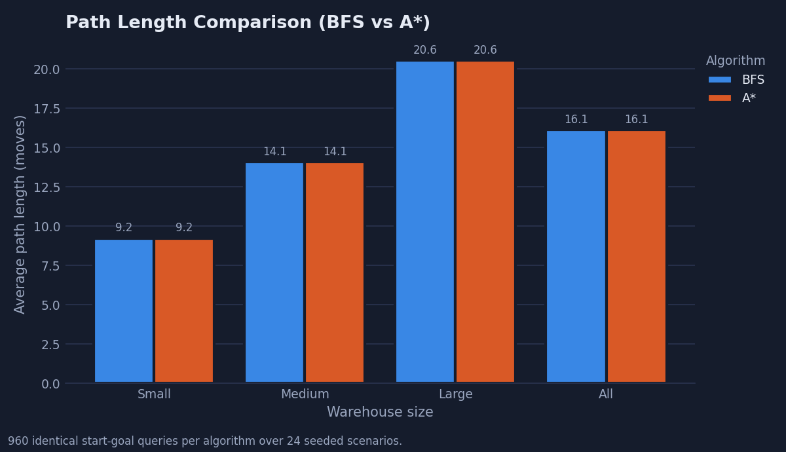 | 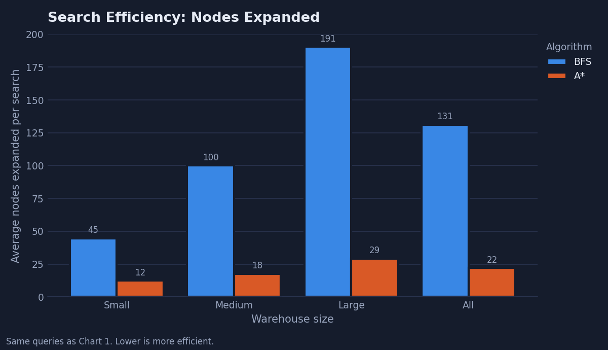 |
| 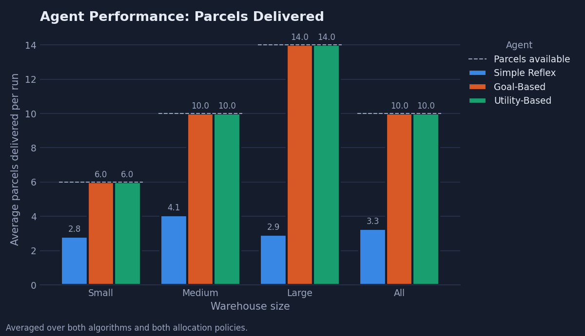 | 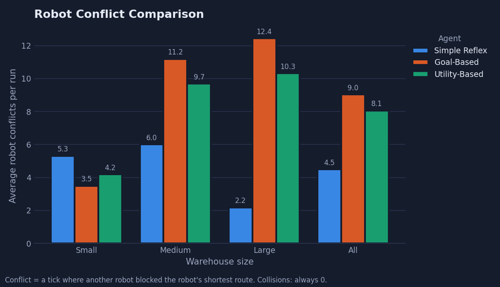 |

## 9. Algorithms and Agents (summary)

- **BFS** - FIFO frontier, visited set, parent pointers. Optimal on unweighted grids. Explores in rings around the start.
- **A\*** - priority queue ordered by f(n) = g(n) + h(n), h(n) = |r₁−r₂| + |c₁−c₂|. Manhattan distance is admissible and consistent for 4-connected unit-cost moves, so A* is optimal and expands each node at most once.
- **Simple Reflex** - condition-action rules on the current percept only (pick up / deliver / greedy step toward the target / random free step if blocked). No search, no memory, so it can get trapped behind shelves.
- **Goal-Based** - formulates the current goal (parcel, then station), plans a full route with the selected algorithm, follows it, waits once if blocked and then replans around robots.
- **Utility-Based** - scores every legal action with a weighted utility (progress, path distance, movement cost, obstacle proximity, conflict, congestion, waiting, revisits) and takes the maximum. Distances come from BFS/A*.

Details, formulas and weights: [docs/ALGORITHMS.md](docs/ALGORITHMS.md). System design: [docs/ARCHITECTURE.md](docs/ARCHITECTURE.md).

## 10. Screenshots

**3D digital twin**

| Opening flythrough | Presentation Mode |
|---|---|
| 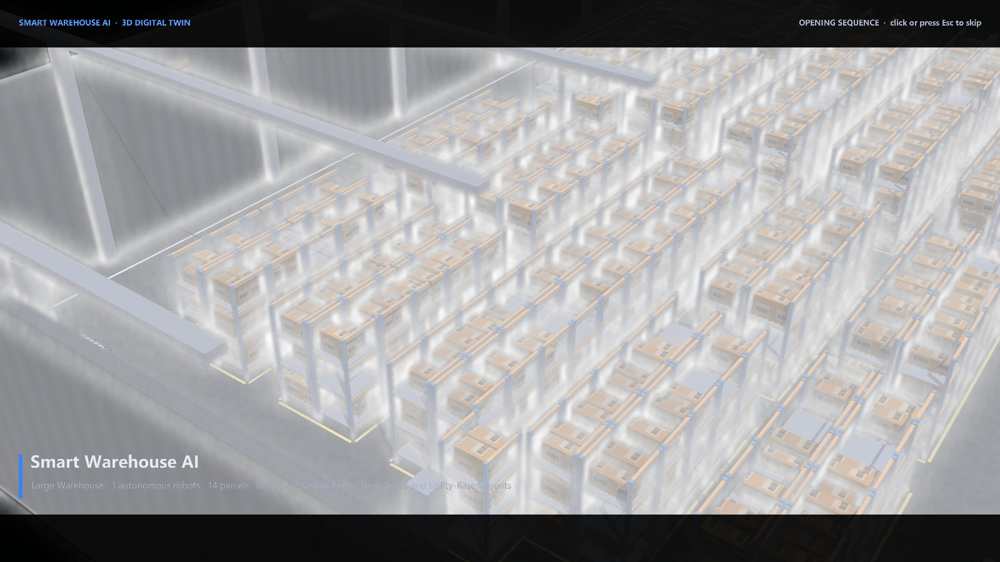 | 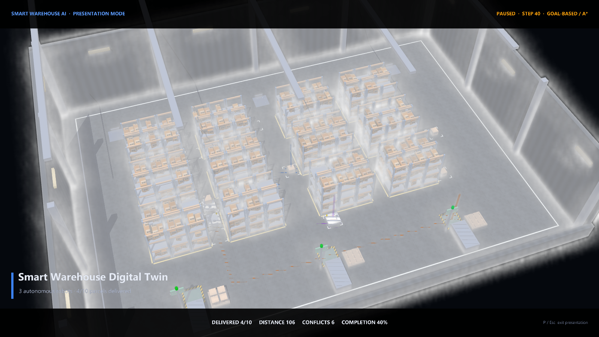 |
| **Robot tracking (third person)** | **Robot focus + utility scores** |
| 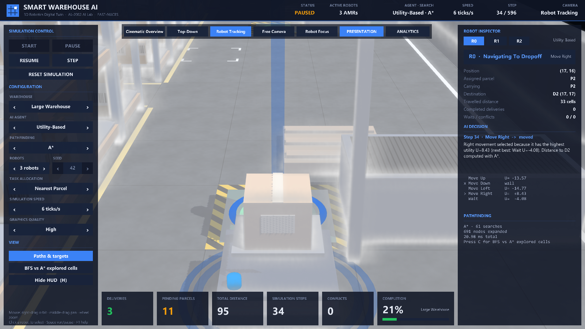 | 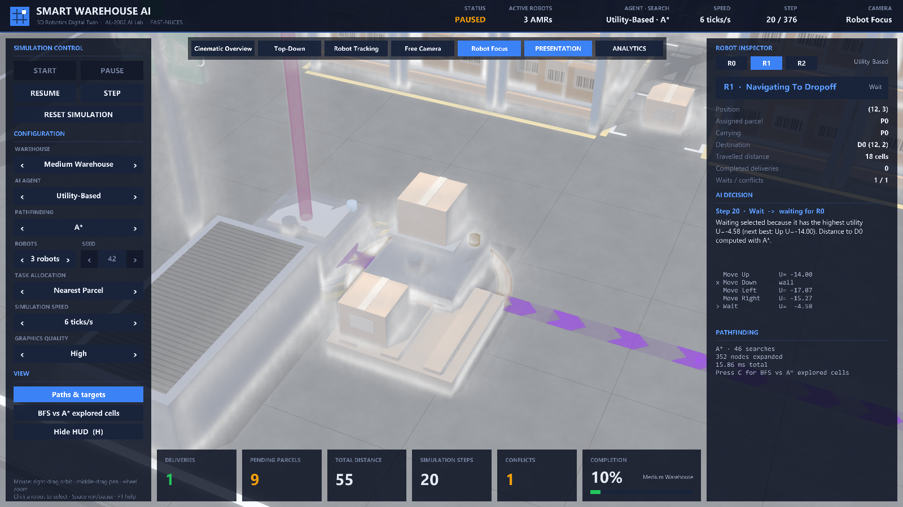 |
| **BFS (blue) vs A\* (orange) explored cells** | **Analytics** |
| 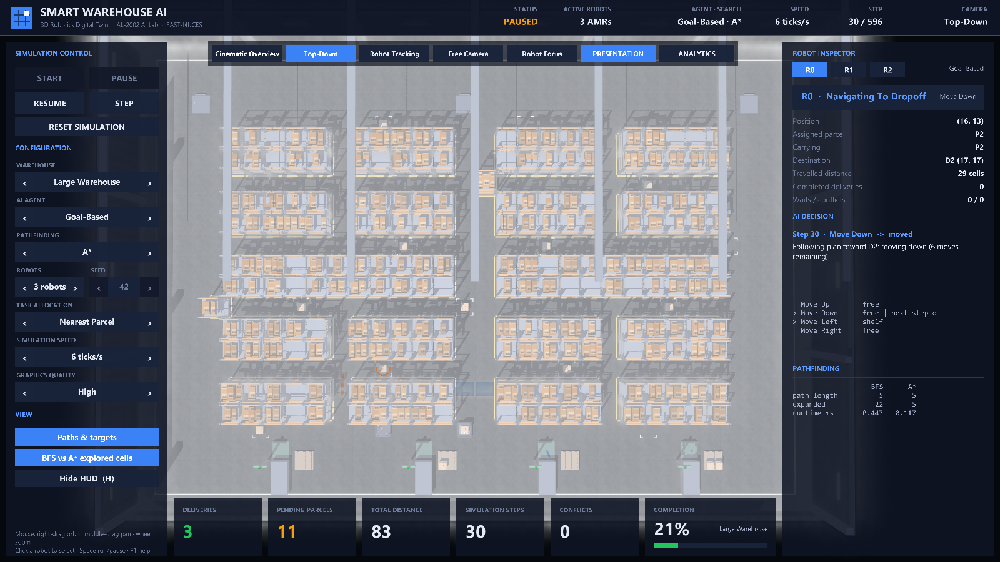 | 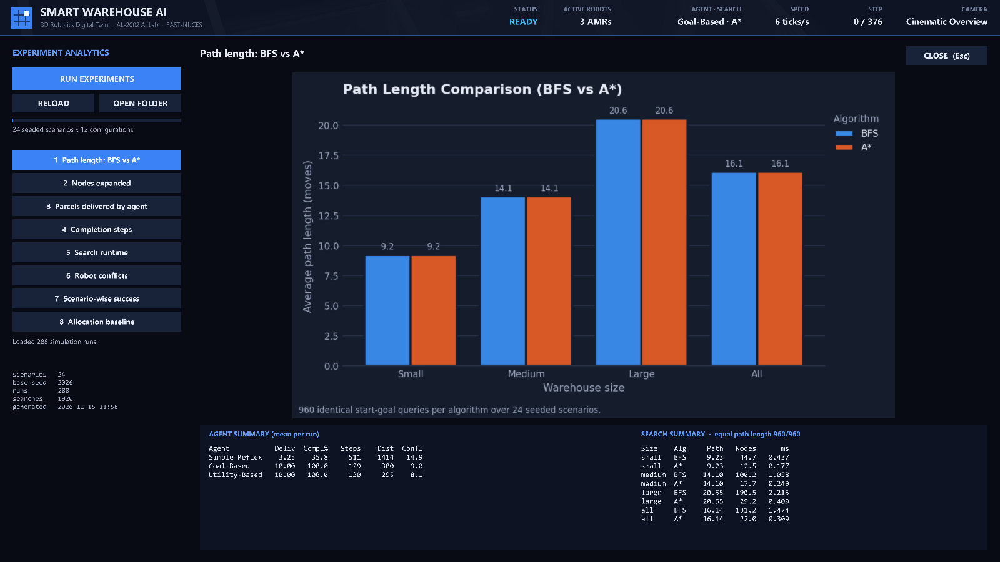 |

**2D dashboard**

| Decision inspector + BFS/A* overlay | Analytics |
|---|---|
| 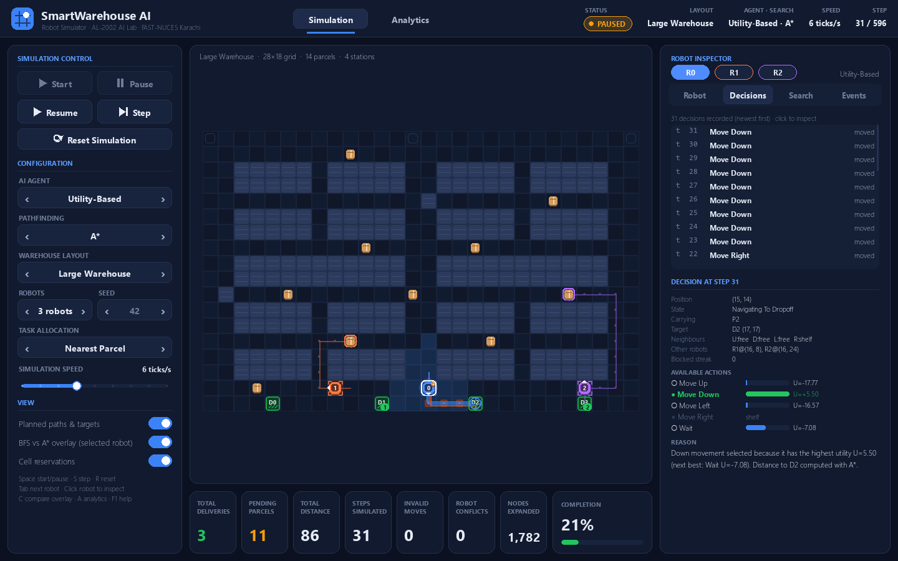 | 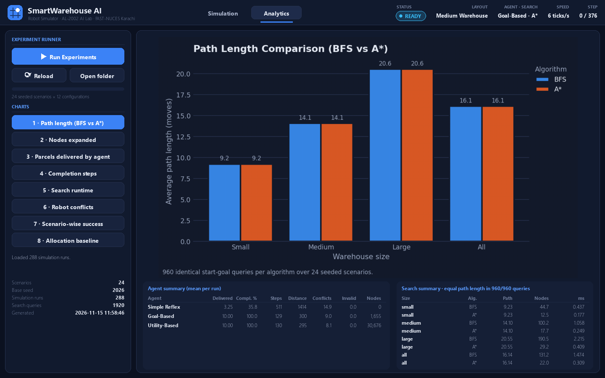 |

## 11. Project Structure

```
main.py                  entry point / CLI
config/settings.py       constants, utility weights, simulation config
environment/             grid, parcel, robot FSM, warehouse invariants, layouts & seeded generator
algorithms/              bfs.py, astar.py, pathfinder.py (from scratch)
agents/                  simple_reflex.py, goal_based.py, utility_based.py
coordination/            conflict_manager.py, reservations.py, task_allocator.py
simulation/              simulation_engine.py, simulation_controller.py, state_manager.py
interface/               2D Pygame dashboard (fallback): warehouse view, panels, analytics, widgets
interface3d/             3D digital twin (Panda3D): sync (GPU-free), scene, robots, effects, camera, HUD, app
experiments/             experiment_runner.py, metrics.py, result_exporter.py, charts.py
data/layouts/            small.json, medium.json, large.json
data/results/            generated experiment output (git-ignored)
tests/                   pytest suite
docs/                    proposal, architecture, algorithms, experiments, demo & viva guide
tools/build_layouts.py   regenerates the predefined layout JSON files
```

## 12. Limitations

- Coordination is decentralised and greedy (turn order + local yielding). It is safe (no collisions) but not an optimal multi-agent path finder such as CBS. Rare deadlock patterns are resolved by retreating, not by global planning.
- The Simple Reflex agent is intentionally memoryless and often fails on larger layouts; this is a property of the architecture, not a bug.
- Search runtimes are wall-clock measurements and vary between machines. Node counts and path lengths are exactly reproducible.
- No physical robots, real maps, learning methods or production WMS integration (outside the approved scope).

## 13. Documentation

- [docs/PROPOSAL.md](docs/PROPOSAL.md) - approved proposal (source of truth)
- [docs/ARCHITECTURE.md](docs/ARCHITECTURE.md) - modules, data flow, tick algorithm, coordination
- [docs/ALGORITHMS.md](docs/ALGORITHMS.md) - BFS, A*, agents, utility function
- [docs/EXPERIMENTS.md](docs/EXPERIMENTS.md) - methodology, metrics, results, discussion
- [docs/VISUALIZATION_3D.md](docs/VISUALIZATION_3D.md) - 3D digital twin design, cameras, presentation, validation
- [docs/DEMO_GUIDE.md](docs/DEMO_GUIDE.md) - live demo script and viva preparation
