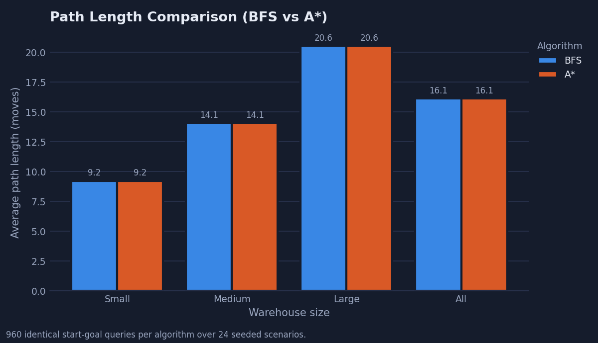
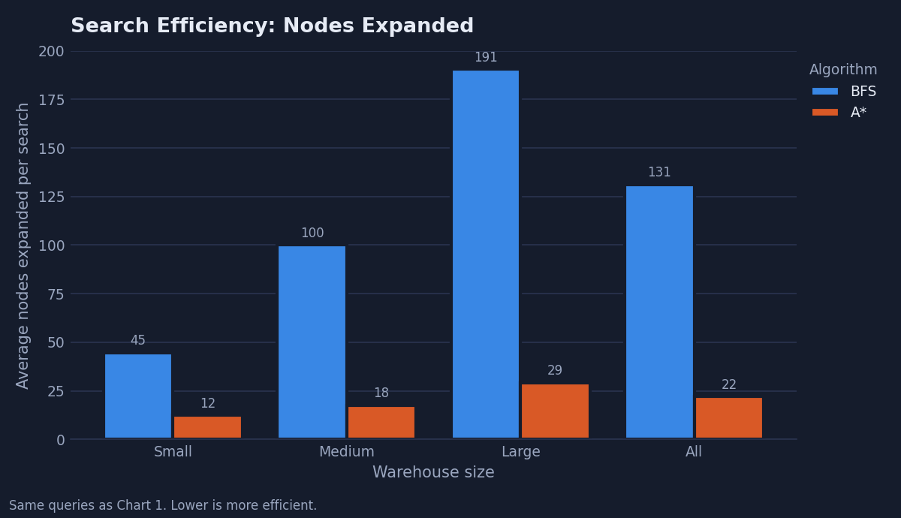
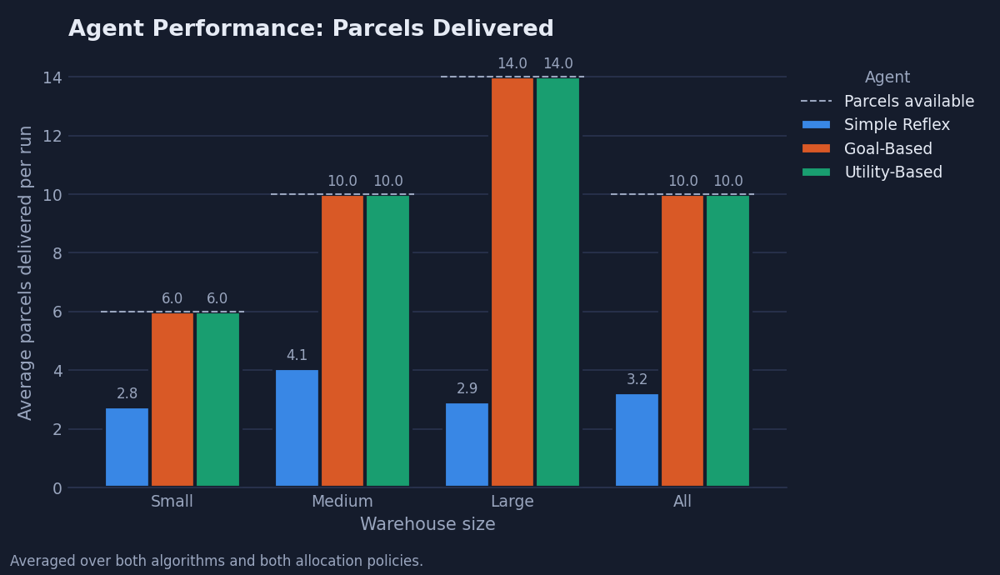
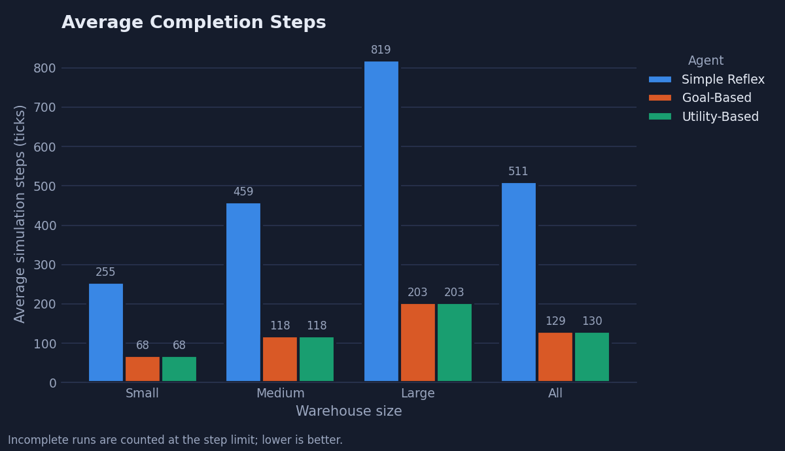
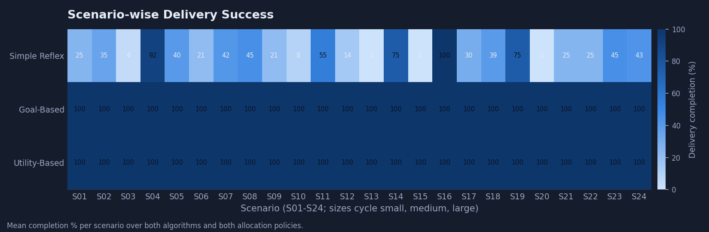

# Experiment Methodology and Results

All numbers in this document come from `python main.py --experiments`
(`experiments/experiment_runner.py`) as recorded in
`data/results/experiment_results.json`. Running the command again reproduces
every count, distance, step and node number exactly. Only wall-clock timings
vary with the machine and its load.

## 1. Scenarios

- **24 scenarios** generated by `generate_random_scenario(seed, size)` with seeds 2026-2049; sizes cycle small → medium → large (8 each).
- Every scenario is validated (no robots/parcels/stations in shelves, unique cells, all stations and parcels reachable). Each one stores its ID, seed, dimensions, shelf configuration, parcel pickups and destinations, station cells and robot start cells. All of this is in the JSON metadata.

| Size | Grid | Shelf cells | Stations | Parcels | Robots | Step limit |
|---|---|---|---|---|---|---|
| small | 14 × 10 | 27-35 | 2 | 6 | 2 | 300 |
| medium | 22 × 14 | 71-81 | 3 | 10 | 3 | 2 × free cells (≈ 450) |
| large | 30 × 20 | 183-200 | 4 | 14 | 3 | 2 × free cells (≈ 800) |

## 2. Experiment A - search benchmark

For each scenario, BFS and A* answer the same queries on the static shelf map:
every robot start → every parcel pickup, and every parcel → its destination
station. That is 960 queries per algorithm (1,920 searches). Each query is
timed 3 times and the minimum is kept, which reduces OS scheduling noise.
This isolates the algorithms from agent behaviour and robot interaction.

## 3. Experiment B - full simulations

Configurations: 3 agents × 2 algorithms × 2 allocation policies = 12, on all
24 scenarios = **288 runs**. Every run builds a fresh `Warehouse` from the same
`Scenario`, so robots, parcels and destinations start identically for every
configuration. A run ends when every parcel is delivered, the step limit is
reached, or no remaining parcel is reachable.

## 4. Metrics

| Metric | Definition |
|---|---|
| Parcels delivered | parcels that reached their destination station |
| Total distance | sum of cells moved by all robots |
| Completion steps | tick at which the last parcel was delivered; incomplete runs count the steps actually simulated (= the step limit) |
| Execution runtime | `compute_time_ms`: wall-clock time spent inside `SimulationEngine.step()`, with no rendering or animation; for searches, `runtime_ms` per query |
| Nodes expanded | sum over every navigation search performed by the agents |
| Invalid moves | attempted moves into shelves/walls and illegal pickup/deliver actions |
| Robot conflicts | ticks in which a robot with a target did not get closer to it while another robot occupied a neighbouring cell on one of its shortest routes, plus moves rejected by the conflict manager |
| Completion % | 100 × delivered / total |

"Conflict" is measured with an exact distance field that is *not* counted in
the agents' search statistics. This way the same definition applies to every
agent, including the reflex agent, which has no plan. **Collisions** (two
robots in one cell) are impossible by construction; the engine checks this
after every tick and it never occurred.

## 5. Results

### 5.1 Search (Experiment A)

| Size | Algorithm | Queries | Avg. path length | Avg. nodes expanded | Avg. runtime (ms) |
|---|---|---|---|---|---|
| small | BFS | 192 | 9.23 | 44.7 | 0.437 |
| small | A* | 192 | 9.23 | 12.5 | 0.177 |
| medium | BFS | 320 | 14.10 | 100.2 | 1.058 |
| medium | A* | 320 | 14.10 | 17.7 | 0.249 |
| large | BFS | 448 | 20.55 | 190.5 | 2.215 |
| large | A* | 448 | 20.55 | 29.2 | 0.409 |
| **all** | **BFS** | 960 | 16.14 | 131.2 | 1.474 |
| **all** | **A\*** | 960 | 16.14 | 22.0 | 0.309 |

- **Path length:** identical in 960/960 queries, which confirms both implementations are optimal.
- **Search effort:** A* expanded 5.96× fewer nodes overall, and the advantage grows with the map (3.6× small → 6.5× large).
- **Runtime:** A* was faster on average in every size class on our machine. Absolute times are hardware dependent; the node counts are the reproducible measure.

### 5.2 Agents (Experiment B)

Mean per run, averaged over both algorithms and both allocation policies (96 runs per agent):

| Agent | Parcels delivered | Completion % | Fully completed runs | Steps | Distance | Conflicts | Invalid moves | Nodes expanded | Engine time (ms) |
|---|---|---|---|---|---|---|---|---|---|
| Simple Reflex | 3.25 | 35.8 | 6 / 96 | 510.9 | 1413.5 | 14.9 | 0 | 0 | 70 |
| Goal-Based | 10.00 | 100.0 | 96 / 96 | 129.5 | 300.1 | 9.0 | 0 | 1,655 | 64 |
| Utility-Based | 10.00 | 100.0 | 96 / 96 | 129.6 | 294.9 | 8.1 | 0 | 30,676 | 296 |

By warehouse size:

| Agent | Completion % (S / M / L) | Steps (S / M / L) | Distance (S / M / L) | Conflicts (S / M / L) |
|---|---|---|---|---|
| Simple Reflex | 45.8 / 40.6 / 21.0 | 254.7 / 458.8 / 819.2 | 471 / 1320 / 2450 | 26.6 / 15.9 / 2.2 |
| Goal-Based | 100 / 100 / 100 | 67.8 / 117.7 / 202.8 | 108 / 279 / 513 | 3.5 / 11.2 / 12.4 |
| Utility-Based | 100 / 100 / 100 | 68.4 / 117.6 / 202.7 | 107 / 272 / 506 | 4.2 / 9.7 / 10.3 |

Per configuration (search cost depends on the algorithm; behaviour almost does not):

| Agent | Algorithm | Allocation | Steps | Distance | Nodes expanded | Engine ms |
|---|---|---|---|---|---|---|
| Goal-Based | BFS | Nearest | 123.9 | 277.7 | 2,622 | 67.7 |
| Goal-Based | A* | Nearest | 123.6 | 278.0 | 405 | 52.9 |
| Goal-Based | BFS | Fixed | 135.1 | 322.5 | 3,120 | 82.2 |
| Goal-Based | A* | Fixed | 135.2 | 322.3 | 472 | 54.5 |
| Utility-Based | BFS | Nearest | 123.1 | 272.0 | 46,757 | 428.7 |
| Utility-Based | A* | Nearest | 123.1 | 272.0 | 6,465 | 117.5 |
| Utility-Based | BFS | Fixed | 136.0 | 317.8 | 60,961 | 514.3 |
| Utility-Based | A* | Fixed | 136.0 | 317.8 | 8,521 | 125.0 |

### 5.3 Charts

Generated in `data/results/charts/` (copies in `docs/images/`):

| # | Chart | File |
|---|---|---|
| 1 | Path length, BFS vs A* (by size) | `chart1_path_length.png` |
| 2 | Nodes expanded, BFS vs A* | `chart2_nodes_expanded.png` |
| 3 | Parcels delivered per agent (with parcels available) | `chart3_agent_deliveries.png` |
| 4 | Average completion steps per agent | `chart4_completion_steps.png` |
| 5 | Search runtime per query | `chart5_search_runtime.png` |
| 6 | Robot conflicts per agent | `chart6_conflicts.png` |
| 7 | Scenario-wise completion % heatmap (24 scenarios × 3 agents) | `chart7_scenario_success.png` |
| 8 | Fixed-order vs nearest allocation (distance) | `chart8_allocation.png` |







## 6. Discussion (claims limited to what the data shows)

1. **BFS vs A\*.** Both are optimal; A* reached the same path lengths with ~6× fewer expansions and less time. For the Utility-Based agent, which performs many searches, the choice of algorithm changed engine time from 429-514 ms to 118-125 ms per run with *identical* behaviour.
2. **Planning matters.** Both search-based agents delivered every parcel in every run. The Simple Reflex agent delivered 35.8% on average and finished only 6/96 runs, because greedy local rules fail behind shelf rows. Its share drops from 45.8% (small) to 21.0% (large). It also travelled about 4.7× more cells.
3. **Goal-Based vs Utility-Based.** Their completion and steps are practically equal (129.5 vs 129.6). Utility-Based travelled slightly less (294.9 vs 300.1 cells) and recorded fewer conflicts (8.1 vs 9.0), consistent with its congestion and conflict penalties. It used about 18× more node expansions (with caching). The data does **not** show one dominating the other on task completion.
4. **Allocation baseline.** Nearest-parcel allocation beat the fixed-order baseline for the planning agents (e.g. Goal-Based distance 322.4 → 277.8 cells, steps 135.1 → 123.8).
5. **Conflicts for the reflex agent** are lower on large maps (2.2) only because its robots rarely meet there; it spends most of its time stuck behind shelves.
6. **Invalid moves were 0** for every agent. All three agents perceive the four neighbouring cells and only choose legal moves. The counter and its rejection path are exercised by unit tests (`test_rejected_move_is_counted_and_robot_waits`, `test_full_pickup_and_delivery_cycle`).
7. **Deadlocks.** Before the priority-retreat mechanism was added, 14 of the 192 planning-agent runs livelocked in dead-end aisles. After it, all completed. On average there were 0.92 (Goal-Based) and 1.52 (Utility-Based) yields per run.

## 7. Threats to validity

- Generated warehouses share one structural style (rack blocks with aisles). Results may differ on other topologies.
- Utility weights were chosen manually and not tuned per scenario.
- Runtime numbers depend on hardware and background load. Use node counts for the algorithmic comparison.
- 2-3 robots is a light load. Congestion effects would be stronger with more robots, which the proposal scope excludes.

## 8. Reproducing

```bash
python main.py --experiments                      # default: 24 scenarios, base seed 2026
python main.py --experiments --scenarios 30 --base-seed 99
python -m experiments.experiment_runner --no-charts
```
