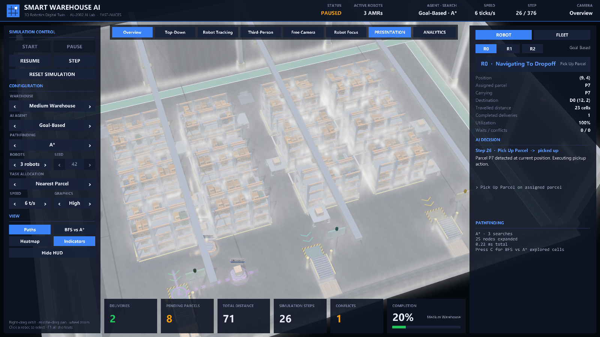

# 3D Digital Twin

The 3D digital twin (`interface3d/`, Panda3D) is a **visualisation layer** on top
of the unchanged simulation. It reads the same `SimulationController` and
`SimulationEngine` that the 2D dashboard and the experiment runner use. It
never moves a robot, changes a decision or alters a metric. Every robot
position, pickup, delivery, path, explored cell and statistic on screen comes
from the live engine.

## 1. Why this design

| Requirement | Decision |
|---|---|
| Do not break working AI logic | No changes to `environment/`, `algorithms/`, `agents/`, `coordination/`, `simulation/`, `experiments/`. The 3D package only reads their state. |
| Realistic 3D in Python, offline | **Panda3D 1.10** (pip wheel, no system dependencies). It provides per-pixel lighting (auto-shader), shadow-mapped lights, post-processing (MSAA, bloom, SSAO), offscreen rendering and DirectGUI. All geometry and textures are procedural (NumPy), so there are no asset files to download or license. |
| Animations must reflect real state | All simulation → visual mapping lives in `interface3d/sync.py`, which is pure Python and unit-tested without a GPU. |
| Separate rendering from simulation | The controller runs fixed-rate ticks (1-32 ticks/s, at most 8 per frame); rendering runs at display rate (vsync). Animations interpolate the last real tick. |
| Fallback | `python main.py` tries 3D first. If Panda3D is missing or no OpenGL context can be created, it prints the reason and starts the 2D Pygame dashboard. `--2d` forces 2D. |

## 2. Modules

| File | Responsibility |
|---|---|
| `interface3d/sync.py` | Grid ↔ world mapping, robot poses (motion profile with acceleration/deceleration, turn-then-drive, reverse during retreats, differential wheels, lift), parcel/dock views, effects from real `TickEvent`s, camera-rig maths, Presentation Mode director with cinematic shots. **No Panda3D import.** |
| `interface3d/intelligence.py` | `FleetTracker`: congestion heat, utilisation, activity, throughput, cycle time, dock progress, sampled once per real tick. **No Panda3D import.** |
| `interface3d/geometry.py` | `MeshBuilder`: boxes, cylinders, rings, discs, convex prisms (chamfered shapes) with normals, vertex colours and UVs. |
| `interface3d/textures.py` | Procedural textures: polished concrete tiles, hazard stripes, corrugated wall, conveyor belt, path chevrons, carton labels. |
| `interface3d/warehouse_scene.py` | Floor with baked ambient occlusion, walls, columns with guards, trusses and high-bay lamps, racks (uprights, beams, decks, end guards; near-only bracing and base plates), cartons/totes/wrapped pallets, parcel stands, floor tape, walkway, aisle IDs and stop lines, charging pads, loading docks (hazard pad, chevrons, roller conveyor, bollards, pallet, live progress sign). Static geometry is split into 8×8-cell chunks with a near-detail LOD layer. |
| `interface3d/robot_model.py` | Low-profile lifting AMR: chamfered accent shell, rubber skirt, 360° LED status band, two differential drive wheels and casters, front lidar in a sensor window, head/tail lights, ID on three sides, e-stop, round lift platform with cargo, halo, selection ring and beam. |
| `interface3d/effects.py` | Animated route ribbons, destination markers, BFS/A* explored cells batched into reveal buckets (real expansion order), event effects with cached nodes, congestion heatmap layer. |
| `interface3d/camera.py` | Six camera modes, timed smootherstep transitions plus damping, `frame_points` shot composition, mouse orbit/pan/zoom, opening flythrough. |
| `interface3d/hud.py` | Command-center HUD: static panels and labels batched into a few geoms per layer, Robot / Fleet tabs, tooltips, loading card, banners; rebuilt on resize. |
| `interface3d/analytics3d.py` | Analytics overlay: KPI tiles, nine recorded charts, summary tables; runs experiments incrementally. |
| `interface3d/app3d.py` | The application: lights, fog, quality presets, on-demand shadow scheduling, per-tick caches, frame loop, input, picking, occlusion avoidance, presentation framing, intelligence overlays. |

## 3. How animation stays faithful to the simulation

For every robot and every frame, `VisualSync.robot_poses(engine, progress, dt)` returns a pose:

- **Position:** interpolated from `previous_position` (the cell before the last tick) to `position` (the cell after it). At `progress = 0` and `progress = 1` the robot is exactly on those real cells, and between them it stays on the segment joining them. This is tested for every agent type.
- **Acceleration and deceleration (V2):** `motion_profile` eases in only if the robot starts from rest, meaning it didn't move the same way in the previous tick. It eases out only if the robot's *own planned path* doesn't continue straight. Consecutive straight cells therefore flow at cruise speed, and the robot slows only before turns, stops and pickups. The endpoints stay exact.
- **Turning:** when the travel direction changes, the first 35% of the tick rotates the robot in place, then it drives. The two drive wheels spin in **opposite directions** while turning (differential drive) and in the same direction while driving. Wheel rotation equals the distance actually travelled divided by the wheel radius.
- **Reverse:** during a coordination retreat (`robot.is_yielding`), a move opposite to the robot's heading is driven in reverse.
- **Pickup (V2):** parcels rest on stands; the low lift robot drives underneath and raises its platform, and the carton is lifted off the stand. The lift height follows `robot.carrying`, and the carton never dips below the stand top.
- **Delivery (V2):** in the tick a parcel becomes DELIVERED, a carton moves from the robot's lift onto the dock conveyor, rolls along it and drops onto the pallet stack. The dock sign updates its `delivered / total` counter.
- **Effects:** created only from engine `TickEvent`s (pickup, deliver, conflict, invalid, yield, wait), at the event's cell.
- **Status lighting:** a 360° LED band follows `robot.state`. Amber blinking means waiting for another robot, cyan pulsing means yielding. The selected robot gets a pulsing ring and a light beam.

## 4. Warehouse intelligence (V2)

`interface3d/intelligence.py::FleetTracker` is registered as a `SimulationController` tick listener, so it samples the engine once per real tick, even when several ticks run in one frame. It never writes to the engine.

| Feature | Data source | Where |
|---|---|---|
| Congestion heatmap (`M`) | decaying per-cell heat: +1 per robot on the cell, +2 if it is waiting or yielding, +3 per conflict event; ×0.96 per tick | floor overlay (vertex colours rewritten in place) |
| Robot utilisation | share of ticks spent moving, handling a parcel, or yielding, out of all ticks, from each robot's executed action | inspector, Fleet tab, robot tags |
| Idle / waiting / yielding indicators | `classify(robot)` on the real `current_action`, `has_task`, `is_yielding` | floating robot tags (`I`), Fleet tab |
| Delivery progress | parcel statuses per destination dock | dock signs + progress bars, Fleet tab |
| Throughput, cycle time | delivery events; `delivered_step − picked_step` per parcel | Fleet tab |
| Active routes | each robot's `planned_path` | animated route ribbons |
| Conflicts / waiting | engine conflict events, waiting robots | heatmap weights, red conflict effects, amber halos |

## 5. Cameras

| Mode | Key | Behaviour |
|---|---|---|
| Overview | O | Slow drifting orbit of the whole warehouse |
| Top-Down | T | Plan view (BFS/A* explored cells, heatmap); roof trusses are hidden when looking steeply down |
| Robot Tracking | K | Elevated tracking shot with a constant viewing direction and slight look-ahead; easy to read |
| Third-Person | F | Chase camera behind the selected robot |
| Free Camera | V | Right-drag orbit, middle-drag pan, wheel zoom |
| Robot Focus | G | Orbit around the selected robot (drag and zoom adjust the offset) |

- **Transitions (V2):** switching modes or shots starts a timed 1.4 s *smootherstep* blend from the current view to the moving target view, with no first-frame jump. After it, the camera follows with frame-rate-independent damping.
- **Occlusion avoidance:** if racks block the line of sight, tracking shots first try nearby headings (usually an aisle-aligned view), otherwise the camera smoothly steepens. This only changes the camera.
- **Opening sequence:** a letterboxed, keyframed flythrough. Click or press Esc to skip.

## 6. Presentation Mode (P)

HUD hidden, letterbox bars, captions and live statistics. The `PresentationDirector` rotates overview → robot tracking → third-person → pathfinding → top-down statistics. In V2, cinematic shots are **composed around real positions** with `CameraController.frame_points`:

- **Pickup highlight:** the robot and the parcel stand where the real pickup happened, at a low angle with a slow orbit.
- **Delivery highlight:** the robot, the dock conveyor and the pallet of the station that received the parcel.
- **Pathfinding:** the robot's actual planned route plus its target, with BFS/A* explored cells for that real query.

A real pickup or delivery interrupts the rotation. Entering or leaving Presentation Mode never pauses, resets or steps the simulation.

## 7. Graphics quality

| Preset | Shadows | Post-processing | Other |
|---|---|---|---|
| Low | off | none | static scene merged into the fewest batches; no near-detail layer |
| Medium (default) | 2048 map, refreshed only when a shadow caster changes (at most every 2nd frame) | MSAA ×4, bloom (small) | depth fog, near-detail LOD |
| High | 4096 map, refreshed only when a caster changes | MSAA ×4, bloom, SSAO | depth fog, near-detail LOD |

Switch with the Graphics selector or `Q`. Unsupported effects are disabled with an on-screen message. Measured performance before and after V2 is in [OPTIMIZATION_V2.md](OPTIMIZATION_V2.md).

## 8. Controls

`Space` run/pause · `S` step · `R` reset · `1 2 3`/`Tab`/click select robot ·
`O T K F V G` cameras · `C` BFS vs A* · `M` heatmap · `I` robot tags · `P` presentation ·
`A` analytics · `H` hide HUD · `Q` quality · `+`/`-` speed · `F1` help · `Esc` close/skip/exit.
Buttons show their shortcut as a tooltip.

## 9. Validation

| Check | Test |
|---|---|
| Robot nodes equal simulated cells after every tick | `test_app3d.py::test_robot_nodes_follow_simulation`, `test_visual_sync.py::test_robot_poses_match_simulation_state` |
| Motion profile exact at both ends, monotonic, correct start/end speeds | `test_visual_v2.py::test_motion_profile_*`, `test_cruising_robots_do_not_stop_between_straight_cells` |
| Differential wheels (opposite spin when turning) | `test_visual_v2.py::test_differential_wheels_turn_in_place_and_drive` |
| Pickup/delivery visuals equal real actions | `test_app3d.py::test_pickup_and_delivery_visuals_match_real_actions`, `test_visual_sync.py::test_effects_come_only_from_real_events` |
| Heatmap, tags, dock signs follow the engine every tick | `test_app3d.py::test_v2_heatmap_indicators_and_docks_follow_engine`, `test_visual_v2.py::test_fleet_tracker_matches_engine`, `test_heat_decays_and_conflicts_counted` |
| Tick listeners fire once per real tick | `test_visual_v2.py::test_tick_listeners_called_once_per_real_tick` |
| Cinematic shots frame real positions; transitions smooth and timed | `test_visual_v2.py::test_director_event_shots_frame_real_positions`, `test_camera_transitions_are_timed_and_smooth`, `test_frame_points_keeps_every_point_in_view` |
| Chunks, LOD, frustum culling | `test_app3d.py::test_v2_chunked_scene_lod_and_frustum_culling` |
| Shadow map refreshes only when casters move | `test_app3d.py::test_v2_shadow_map_refreshes_only_when_casters_move` |
| No node leaks across rebuilds; loading card removed | `test_app3d.py::test_v2_resources_released_on_rebuild` |
| HUD batching, tooltips, banners | `test_app3d.py::test_v2_hud_is_batched` |
| Floor overlays visible with post-processing (depth regression) | `test_app3d.py::test_v2_floor_overlays_visible_with_post_processing` |
| BFS/A* overlay, pause/resume/reset, presentation, cameras, quality, analytics, intro | V1 `test_app3d.py` tests |
| 2D fallback | `test_launcher.py` |

The Panda3D tests render offscreen and are skipped automatically on machines without OpenGL.

## 10. Limitations

- Geometry is procedural and stylised (no photogrammetry or PBR texture sets). Lighting is Panda3D's auto-shader (Blinn-Phong with shadow maps) rather than a full PBR pipeline, chosen for reliability on integrated GPUs.
- SSAO from `CommonFilters` is approximate and subtle; the floor's baked ambient occlusion provides most of the contact shading.
- Hardware instancing is not used: Panda3D's auto-shader doesn't support it, and merged per-chunk batches give fewer draw calls for this static scene.
- If the frame rate drops below the selected tick rate, the animation skips intermediate cells. The simulation itself is unaffected.
- Utilisation in the experiment analytics (chart 9) is *movement* utilisation, derived from recorded distance and steps. The live Fleet utilisation also counts parcel handling and yielding.
